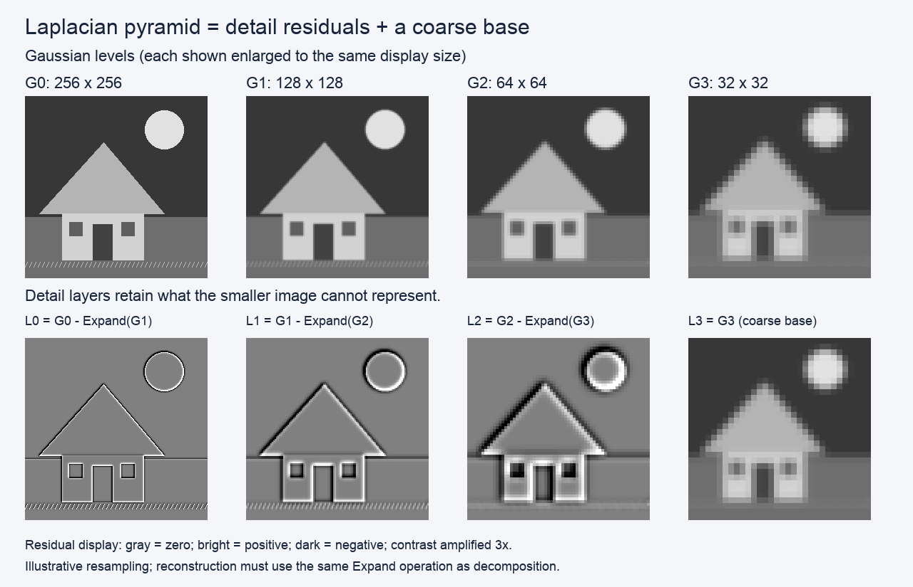
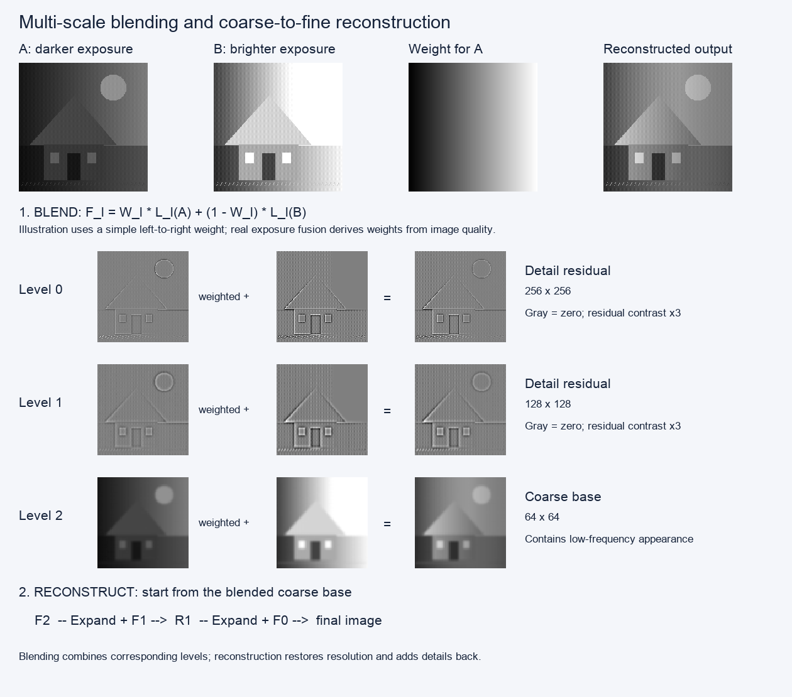

# Algorithm Specification

## Input and numerical conventions

- Accept one or more pre-aligned, same-size RGB images of a static scene; a
  typical bracket has multiple exposures. Alignment and ghost removal are out
  of scope. Reject missing images, mismatched dimensions, invalid pixel values,
  or unsupported formats with an explicit error.
- Decode 8-bit RGB values to `float32` in `[0, 1]` by dividing by 255. Operate
  directly on these encoded RGB values, without linearizing them. Use
  `float32` for weights, pyramid levels, blending, and reconstruction.
- Keep intermediate and reconstructed values unclipped for correctness
  comparisons. For a viewable 8-bit output, clamp the final RGB values to
  `[0, 1]`, multiply by 255, and round to the nearest integer.
- Default to at most five pyramid levels, counting the original image as level
  zero; stop earlier when both dimensions reach one. Allow a smaller explicit
  level count and reject counts below one or beyond that limit.

## Weight computation

For exposure $i$ and pixel $p = (x, y)$, let $R_i(p)$, $G_i(p)$, and
$B_i(p)$ be the RGB values. Compute three measures, each with exponent 1:

1. **Contrast:** Convert to grayscale and take the absolute value of the
   four-neighbor Laplacian:

   $$
   \begin{aligned}
   Y_i(p) &= 0.299 R_i(p) + 0.587 G_i(p) + 0.114 B_i(p), \\
   C_i(p) &= \left|Y_i(x-1,y) + Y_i(x+1,y) + Y_i(x,y-1)
              + Y_i(x,y+1) - 4Y_i(p)\right|.
   \end{aligned}
   $$

2. **Saturation:** Compute the population standard deviation of the channels:

   $$
   \begin{aligned}
   \mu_i(p) &= \frac{R_i(p) + G_i(p) + B_i(p)}{3}, \\
   S_i(p) &= \sqrt{\frac{(R_i(p)-\mu_i(p))^2 +
   (G_i(p)-\mu_i(p))^2 + (B_i(p)-\mu_i(p))^2}{3}}.
   \end{aligned}
   $$

3. **Well-exposedness:** Multiply a Gaussian measure for each channel:

   $$
   E_i(p) = \prod_{c \in \{R,G,B\}}
   \exp\left(-\frac{(I_{i,c}(p)-0.5)^2}{2(0.2)^2}\right),
   $$

   where $I_{i,c}(p)$ is the value of channel $c$.

For $N$ exposures, add epsilon to the product and normalize across exposures
at each pixel:

$$
w_i(p) = C_i(p)S_i(p)E_i(p) + 10^{-12},
\qquad
W_i(p) = \frac{w_i(p)}{\sum_{j=1}^{N} w_j(p)}.
$$

Adding epsilon before normalization gives equal weights when every exposure
has zero contrast or saturation.

## Building pyramids

In this section, we describe how to build pyramids for images and weight maps, which are used for multi-scale blending.
- For each normalized weight map, we build a Gaussian pyramid using the same reduce operation.
- For each RGB image, we build a Laplacian pyramid by first constructing a Gaussian pyramid and then taking differences between levels.

We use the separable five-tap **Gaussian kernel** in each dimension:

$$
h[-2], h[-1], h[0], h[1], h[2] = \frac{1}{16}[1, 4, 6, 4, 1].
$$

For all neighborhood operations, **reflect indices** without repeating the edge:
for length $n > 1$, the sequence around the left edge is
`... 2, 1, 0, 1, 2 ...`; repeat this reflection as needed. For $n = 1$, every
index maps to zero.

**Reduce** applies Gaussian filtering and samples even coordinates. For an
image or scalar map $A$, using reflected indices outside its bounds:

$$
\operatorname{reduce}(A)(x,y) =
\sum_{a=-2}^{2}\sum_{b=-2}^{2} h[a]h[b]A(2x+a, 2y+b).
$$

The next level has dimensions
$\lceil\text{width}/2\rceil \times \lceil\text{height}/2\rceil$, including
for odd dimensions.

**Expand** produces the exact dimensions of the preceding finer level. In one
dimension, for fine coordinate $x$ and coarse array $A$:

$$
\operatorname{expand}_{1D}(A)(x) =
2 \sum_{\substack{i \in \mathbb{Z}\\-2 \le x-2i \le 2}}
h[x-2i]\,A(i).
$$

Reflect coarse indices outside the array and apply this operation separably in
both dimensions.

For $K$ levels numbered $0$ through $K-1$, build Gaussian pyramids for
each RGB image $I_i$ and normalized weight map $W_i$:

$$
\begin{aligned}
G^I_{i,0} &= I_i, & G^I_{i,\ell+1} &= \operatorname{reduce}(G^I_{i,\ell}), \\
G^W_{i,0} &= W_i, & G^W_{i,\ell+1} &= \operatorname{reduce}(G^W_{i,\ell}).
\end{aligned}
$$

The image Laplacian pyramid is defined by:

$$
L_{i,\ell} =
\begin{cases}
G^I_{i,\ell} - \operatorname{expand}(G^I_{i,\ell+1}), & 0 \le \ell < K-1, \\
G^I_{i,K-1}, & \ell = K-1.
\end{cases}
$$

## Blending and reconstruction

Blend each level, applying the scalar weight to every RGB channel, then
reconstruct from coarse to fine:

$$
\begin{aligned}
B_{\ell} &= \sum_{i=1}^{N} G^W_{i,\ell} L_{i,\ell}, \\
F_{K-1} &= B_{K-1}, \\
F_{\ell} &= B_{\ell} + \operatorname{expand}(F_{\ell+1}),
             \quad \ell = K-2,\ldots,0.
\end{aligned}
$$

The final fused image is $F_0$.

## Correctness checks

Compare CPU and CUDA weights, pyramid levels, blended levels, and final
floating-point outputs using maximum absolute error and RMSE. Record tolerances
and investigate discrepancies, particularly around boundaries. Also check that
normalized weights sum to approximately one, that a single-exposure result
reconstructs its input, and that constant, impulse, and odd-sized inputs
behave consistently. Visual inspection complements these checks but does not
replace them.

