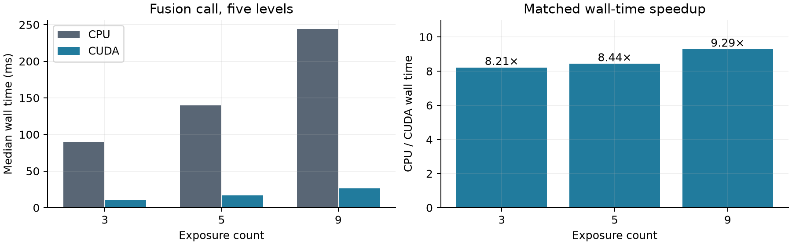
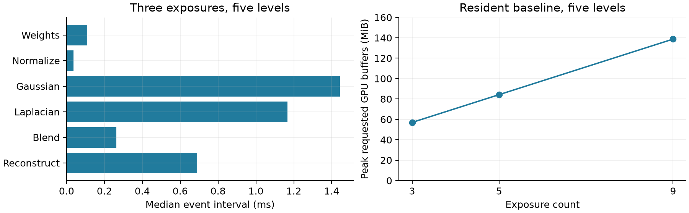

# CUDA-Accelerated Multi-Exposure Image Fusion

**Milestone Report — November 23, 2026**

**Estella Xie (ziyoux), Junhao Li (junhaoli)**

## Implementation and design

We have completed a serial CPU reference and a working CUDA baseline for Mertens exposure fusion. Both compute contrast, saturation, and well-exposedness weights, normalize them across exposures, build Gaussian weight pyramids and Laplacian image pyramids, blend the levels, and reconstruct one output image. They share the same floating-point, sampling, and reflected-boundary rules. The command-line application accepts aligned RGB PNG/PPM inputs, supports different pyramid depths, and saves the fused image.

The CUDA baseline keeps all input pyramids in GPU memory and launches separate kernels for most operations. Reduction already combines filtering with downsampling. Shared-memory tiling, systematic buffer reuse, and incremental processing remain to be implemented and evaluated. We have added stage timing, device-buffer allocation tracking, CPU/GPU comparisons, and profiling scripts. All 25 tests passed on the GPU machine, including intermediate-stage comparisons, synthetic edge cases, and real-image validation.

## Preliminary results

Experiments used an Intel Core i7-9700 and NVIDIA RTX 2080 on ghc40, CUDA 11.7, and a Release build. We tested the Memorial scene at 484 by 714 pixels, with 1/3/5/9 exposures and 1–5 pyramid levels: 20 cases, each with two warmups and ten measured trials.

The table reports median fusion-call wall time. Image loading/saving is excluded; CUDA wall time includes transfers and allocation/cleanup.

| Exposures, five levels | CPU (ms) | CUDA (ms) | Speedup |
|---|---:|---:|---:|
| 3 | 89.387 | 10.882 | 8.21x |
| 5 | 140.025 | 16.600 | 8.44x |
| 9 | 244.236 | 26.298 | 9.29x |

CUDA is about eight to nine times faster in these cases. More exposures generally increase runtime. For three exposures, increasing depth from two to five raises CUDA time from 9.106 to 10.882 ms: later levels add less work because their images are smaller.

For three exposures and five levels, the CUDA event pipeline took 3.715 ms. Gaussian construction took 1.444 ms and Laplacian construction 1.166 ms, together about 70% of that interval. Weight computation, normalization, blending, and reconstruction took 0.110, 0.036, 0.263, and 0.690 ms, respectively. Pyramid operations are therefore our first kernel-optimization target. Event intervals can include idle time; their difference from wall time is not a direct measurement of transfer cost.

| Exposures, five levels | Peak requested GPU buffers (MiB) | Allocations per call |
|---|---:|---:|
| 3 | 56.99 | 74 |
| 5 | 84.22 | 98 |
| 9 | 138.68 | 146 |

Memory use and allocation count grow with exposure count, motivating buffer reuse and incremental execution. These measurements exclude CUDA driver/context memory. Tracked live bytes returned to zero after every instrumented trial.

The largest CUDA-versus-CPU maximum absolute error was 3.58e-7; the largest RMSE was 2.34e-8, below our test limits of 2e-5 and 2e-6. This supports numerical correctness; visual quality will be evaluated separately.

Profiling also identifies overhead outside the kernels. The three-exposure, five-level CLI run made 74 allocations and 104 device synchronizations. The current implementation synchronizes after each kernel to check execution errors. We will test buffer reuse and fewer explicit waits alongside filtering improvements. Profiled allocation time includes CUDA startup, so it does not establish the allocation share of steady-state runtime.

## Progress and remaining goals

The proposal's **50% functional-baseline target is complete**, consistent with the planned CPU and CUDA implementation schedule. We have baseline measurements but no measured optimized-versus-baseline comparison yet.

We still aim to complete the **100% target** by the poster session:

1. Optimize neighborhood operations using shared-memory tiling and an explicitly compared kernel-fusion variant.
2. Reuse buffers and reduce unnecessary synchronization while preserving correctness.
3. Implement multi-pass incremental execution and compare it with the current full-resident mode. A first pass will accumulate the weight sum; a later pass will recompute or reload each exposure's weights and accumulate its normalized pyramid contribution.
4. Compare changes individually and together using wall time, stage timing, peak buffer memory, numerical error, and visual examples across more scenes and resolutions.

The **150% goals**—automatic memory-budget planning and overlapping transfers with computation—remain optional. We will attempt them only after the core comparisons are complete.

## Main concerns

- **Unusual timings:** single-exposure CUDA wall time rose from 11.284 ms at one level to 111.919 ms at five levels; three-exposure processing was also slower at one level than at two. We will repeat timing-only runs on an idle machine and inspect synchronization and GPU activity before drawing scaling conclusions.

- **Limited input coverage:** results currently cover one scene and one resolution. We need more aligned scenes, resolution sweeps, and visual alignment checks.

- **Incremental normalization:** every normalized weight depends on all exposures. The multi-pass design must preserve this dependency while trading memory savings against recomputation and transfers.

- **Optimization uncertainty:** tiling and fusion may help large levels but add overhead or resource pressure at small levels. We need measured comparisons to decide which changes to retain.

## Schedule

| Dates | Estella Xie | Junhao Li |
|---|---|---|
| Nov 24–26 | Implement weight-sum and normalized contribution passes for incremental execution. | Implement shared-memory filtering and a neighborhood-fusion comparison. |
| Nov 27–30 | Integrate incremental execution and validate against the resident baseline. | Integrate buffer reuse and reduced synchronization; measure correctness and memory. |
| Dec 1–3 | Compare execution modes across exposure counts and additional scenes. | Run depth/resolution sweeps and separate optimization comparisons. |
| Dec 4–6 | Complete memory/runtime analysis; attempt planning if core work is complete. | Complete kernel analysis; attempt transfer overlap if core work is complete. |
| Dec 7–10 | Finalize evaluation and the Dec 10 final report. | Finalize poster figures, visual examples, and CLI demonstration. |
| Dec 11 | Present incremental-execution and memory results. | Present kernel/performance results and demonstrate the application. |

## Poster and submission

We plan to demonstrate the command-line application and show input exposures beside fused outputs. Graphs will compare CPU, baseline CUDA, and optimized runtime; explain stage costs; and show the memory/runtime trade-off between resident and incremental execution.

## Reference

Tom Mertens, Jan Kautz, and Frank Van Reeth. Exposure Fusion. Pacific Graphics, 2007. [Paper](https://www.tommertens.com/old-academic/papers/exposure_fusion_reduced.pdf).
